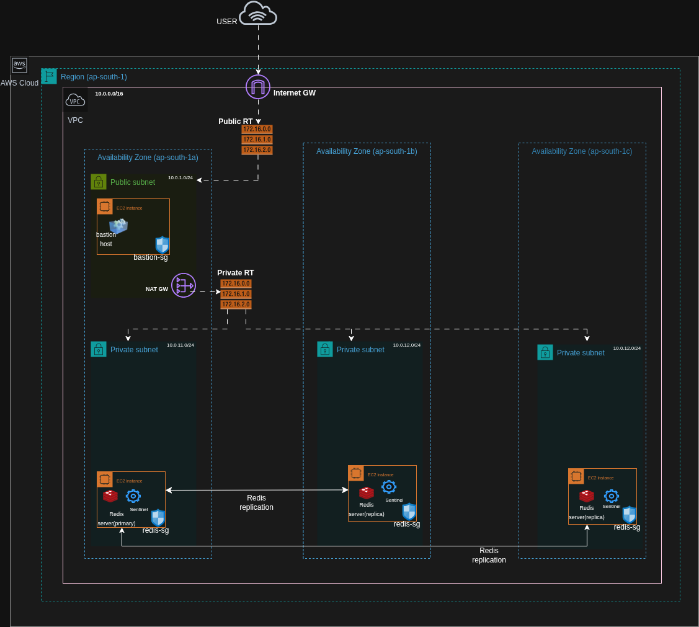

# Redis High Availability with Redis Sentinel on AWS

## Index

1.  [Overview](#overview)
2.  [Prerequisites](#prerequisites)
3.  [Infrastructure Architecture](#infrastructure-architecture)
4.  [How It Works](#how-it-works)
5.  [Deployment](#deployment)
6.  [Verification](#verification)
7.  [Cleanup](#cleanup)

## Overview

This project automates deployment of a highly available Redis
primary-replica setup on AWS using **Terraform, Ansible, and Jenkins**.
Redis Sentinel monitors the Redis nodes and performs automatic failover
when the primary becomes unavailable.

## Prerequisites

-   **AWS:** An AWS account, an IAM identity with permissions to create
    and delete the required networking and EC2 resources, and an EC2 key
    pair.

-   **Terraform:** Installed on the Jenkins agent; provisions and
    destroys AWS infrastructure.

-   **Ansible:** Installed on the Jenkins agent; configures Redis and
    Sentinel on the EC2 instances.

-   **Jenkins:** Configured with access to this Git repository, AWS
    credentials, and the SSH private key.

-   **Python 3:** A supported Python environment for Ansible and its AWS
    inventory dependencies.

-   **boto3 and botocore:** Installed in the same Python environment
    used by Ansible to communicate with AWS services, for AWS dynamic inventory. Use versions compatible
    with the installed `amazon.aws` collection.
    
    Boto3: AWS SDK for Python. It allows Ansible to interact with AWS services such as EC2.
    
    Botocore: The underlying library that handles AWS API requests, authentication, and responses. Boto3 depends on it.

-   **Ansible AWS collection:** Install it with:

    ``` bash
    ansible-galaxy collection install amazon.aws
    ```

-   **AWS CLI:** Installed and configured for the AWS account used by
    Jenkins.

Keep the SSH private key secure and do not commit it to Git. Ensure the
Jenkins user can read the key and access the configured AWS credentials.

## Infrastructure Architecture

The infrastructure is deployed in the AWS Mumbai region (`ap-south-1`)
across three Availability Zones.

-   One VPC with public and private subnets.
-   One public subnet containing a bastion EC2 instance for SSH access.
-   Three private subnets, each containing one Redis EC2 instance.
-   One Redis primary and two replicas, with Redis Sentinel installed on
    all three instances.
-   One Internet Gateway and one NAT Gateway. The NAT Gateway provides
    outbound internet access for private instances.
-   Security groups and route tables control network access and traffic
    flow.

### Architecture Diagram



## How It Works

1.  **Code checkout:** Jenkins checks out the project from the Git
    repository.
2.  **Infrastructure provisioning:** Terraform creates the VPC, subnets,
    gateways, route tables, security groups, bastion host, and three
    Redis EC2 instances.
3.  **Bastion connection check:** Jenkins reads the bastion public IP
    from Terraform output and verifies SSH connectivity using the
    configured private key. `StrictHostKeyChecking=accept-new` accepts a
    previously unseen host key.
4.  **Configuration management:** Ansible uses AWS EC2 dynamic inventory
    (with `boto3`, `botocore`, and the `amazon.aws` collection) to
    discover the Redis instances and configure Redis and Sentinel.
5.  **Replication:** One Redis node is configured as the primary; the
    other two replicate its data.
6.  **Monitoring and failover:** Sentinel monitors the primary and
    replicas. If the primary fails, Sentinel can promote an eligible
    replica. Clients can query Sentinel to discover the current primary.

## Deployment

1.  Clone the repository and configure AWS credentials for the account
    where resources will be created.
2.  Configure the EC2 key pair name in Terraform variables and make the
    matching private key available to the Jenkins user.
3.  Update machine-specific SSH key paths in the Jenkinsfile and ensure
    the Ansible AWS inventory configuration matches the project.
4.  Configure the Jenkins job to use this repository and the intended
    branch.
5.  Run **Build Now** and check the Console Output for successful
    Terraform and Ansible stages.

The pipeline obtains the bastion IP dynamically from Terraform output;
do not hardcode an ephemeral bastion IP.

## Verification

-   Check the Redis role on each node:

    ``` bash
    redis-cli INFO replication
    ```

-   Check Sentinel's view of the master and replicas:

    ``` bash
    redis-cli -p 26379 SENTINEL master mymaster
    redis-cli -p 26379 SENTINEL replicas mymaster
    redis-cli -p 26379 SENTINEL get-master-addr-by-name mymaster
    ```

-   Write test data to the current primary and read it from a replica:

    ``` bash
    redis-cli SET demo:message "Hello from Redis primary"
    redis-cli GET demo:message
    ```

-   Test failover by stopping Redis on the current primary:

    ``` bash
    sudo systemctl stop redis-server
    ```

    Query Sentinel from another node to confirm that a replica was
    promoted. Restart Redis on the stopped node after the test:

    ``` bash
    sudo systemctl start redis-server
    ```

Connect to private instances through the bastion using current IP
addresses from Terraform/AWS; do not reuse IP addresses from an earlier
deployment.

## Cleanup

Destroy resources using the same Terraform working directory and state
used by the Jenkins deployment:

``` bash
cd /var/lib/jenkins/workspace/redis-sentinel-deploy/redis-infra
terraform destroy
```

Review the plan and type `yes` when prompted. Confirm cleanup with:

``` bash
terraform state list
```

An empty state listing means no resources remain managed by that
Terraform state. Keep the Terraform state until destruction is complete;
do not delete it before running `terraform destroy`.
